[开发：KK-Tiong_Pavelio](https://ichxjz.com/)
# Visitor Analytics Workbench

轻量访客统计工作台，从 Nginx 访问日志查看浏览趋势、访客构成、地区分布、请求链路和域名流量。React + Canvas + SVG，无数据库、无付费统计服务。

> 默认演示使用 **2026-10-16 从 ichxjz.com 实际日志提取的脱敏固定快照**。738 PV、430 UV、69,357 次请求都来自真实聚合记录；固定快照不会伪装成实时数据。接入自己的日志后，可自动刷新。

## 实际界面演示

以下 GIF 于 **2026-10-17 重录**，原六个重点视图均加入清晰可见的 `KK-Tiong_Pavelio` 署名。所有演示使用同一份真实周统计快照，动画和交互由应用实际执行。

| 仪表盘 | 访客监测 |
| --- | --- |
| 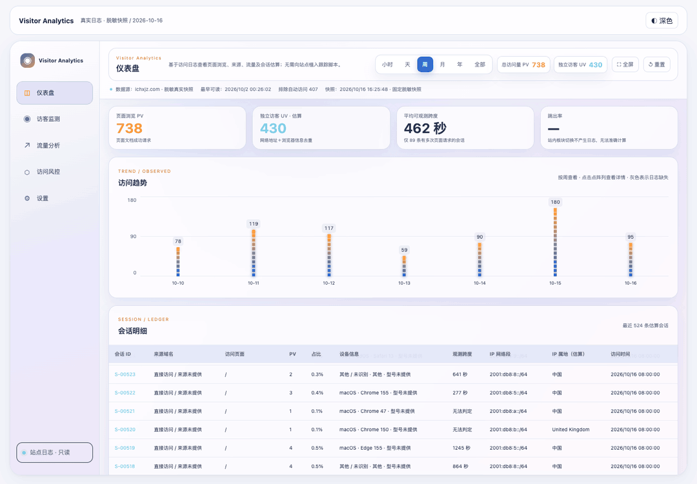 |  |
| **地区详情** | **规则链路** |
|  | 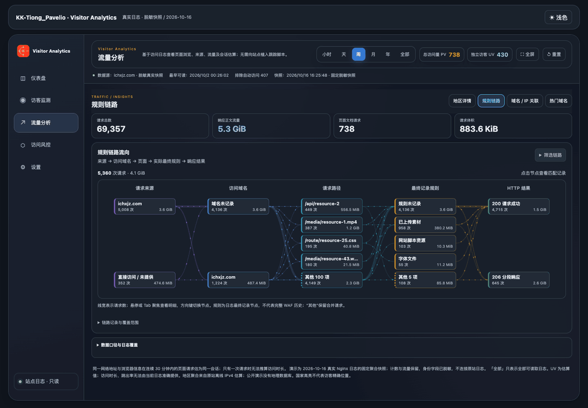 |
| **域名 / IP 关联** | **热门域名** |
| 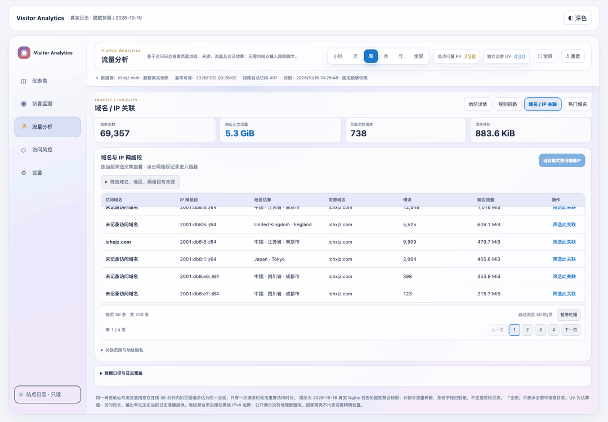 | 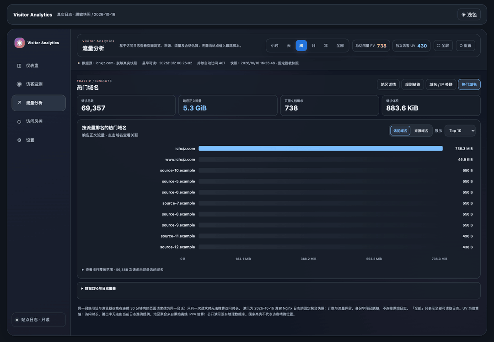 |

### 新增深浅主题对照 / Dark and light recordings

深色、浅色各新增四张实录；每帧均保留 `KK-Tiong_Pavelio` 作者信息，使用相同数据便于对照。

| 页面 | 深色主题 | 浅色主题 |
| --- | --- | --- |
| 仪表盘 | 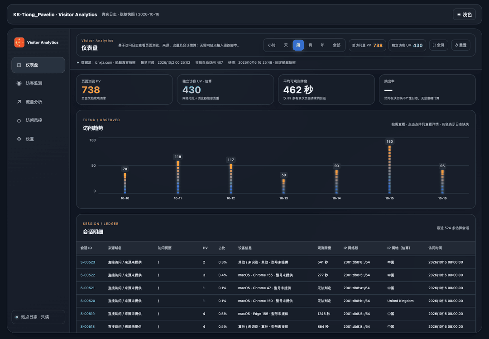 | 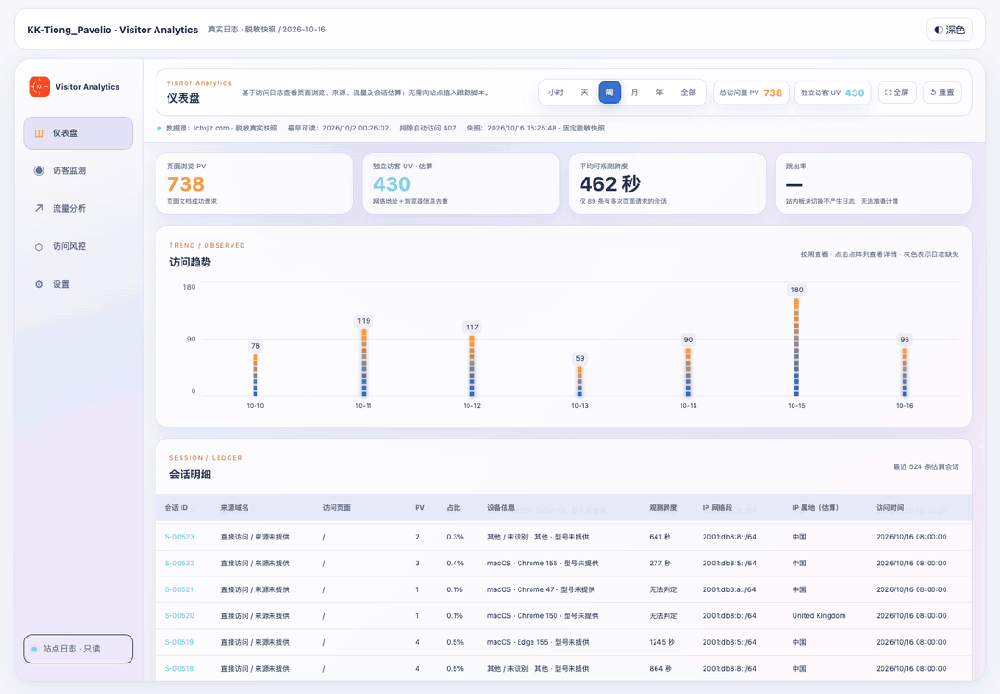 |
| 访客监测 | 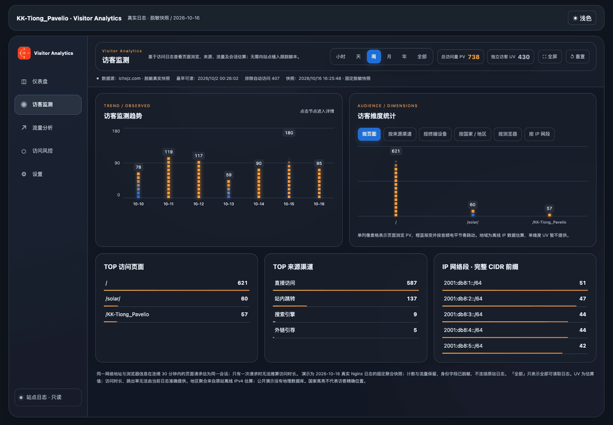 | 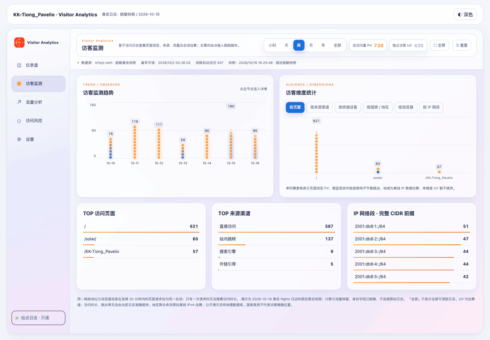 |
| 地区详情 | 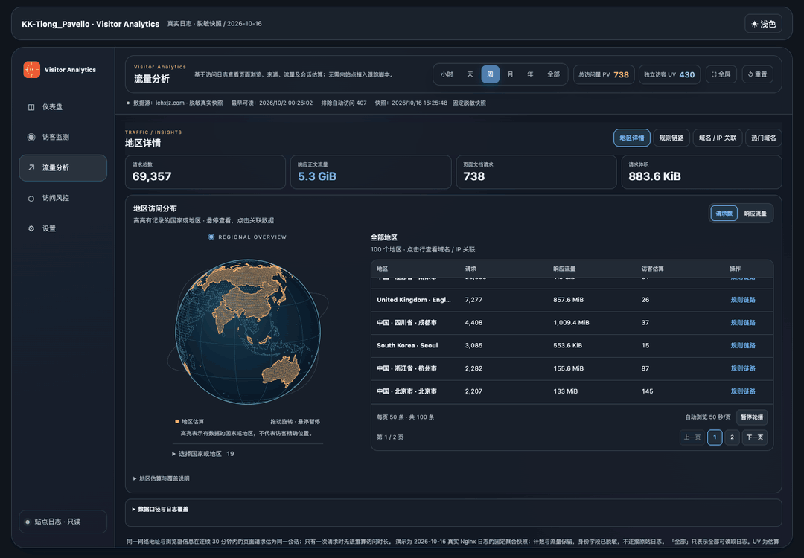 | 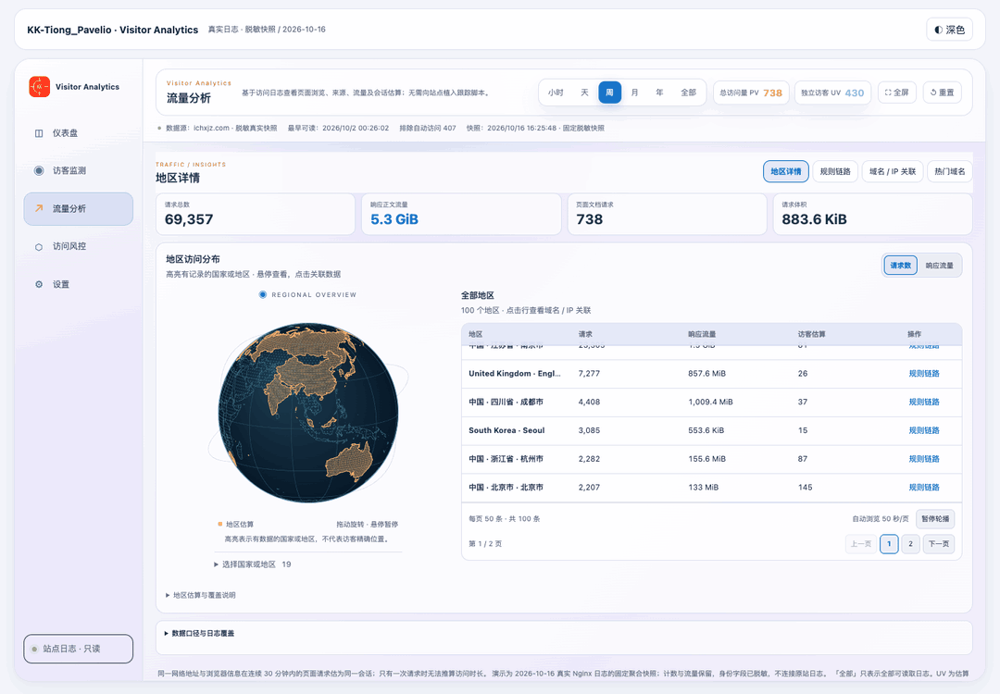 |
| 规则链路 | 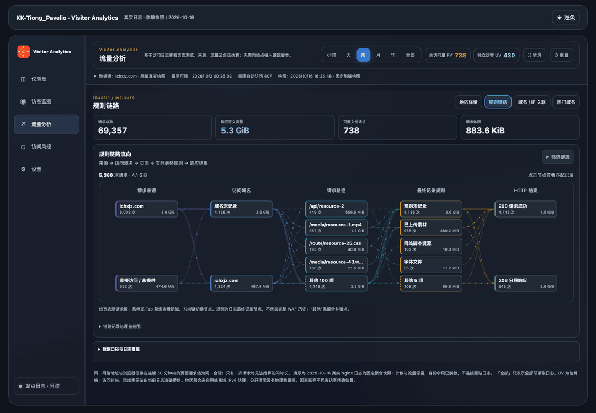 | 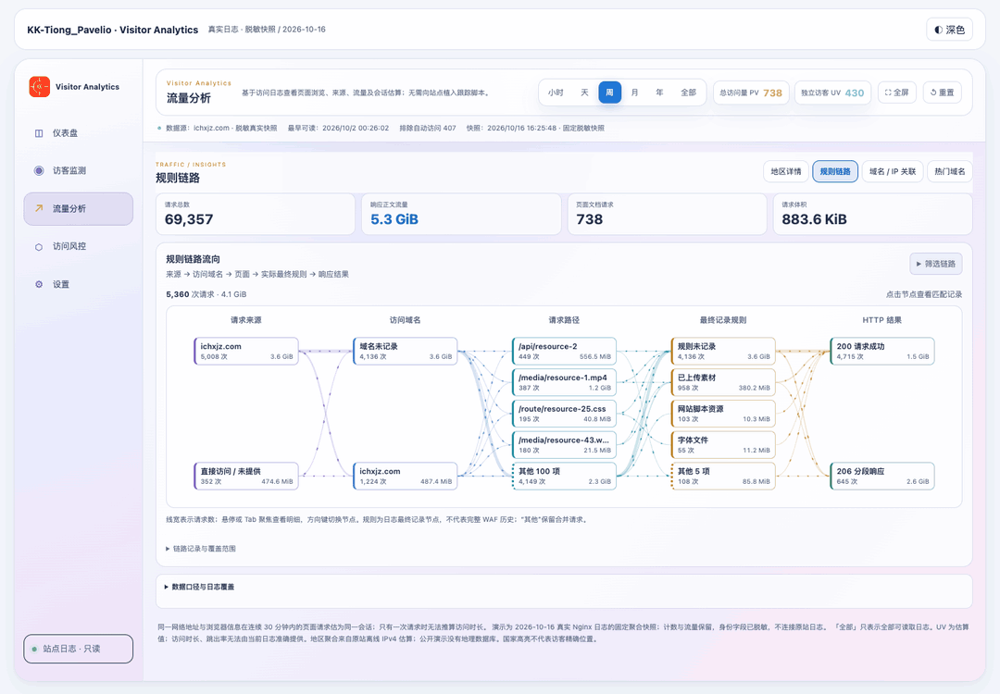 |

## 启动

需要 Node.js 22.12+（或 20.19+）。默认地址为 `http://127.0.0.1:5187`。

```bash
npm ci
npm run dev
```

打开终端显示的本机地址。默认即可查看六种时间范围的脱敏真实数据；无需账号、密钥或外网数据服务。

```bash
npm test
npm run build
npm run preview
```

构建后的 `dist/` 可部署到支持 SPA 的静态服务器。公开静态演示只包含快照；本机日志读取和精确地址 API 不会随静态包部署。

## 功能

- 仪表盘：PV / UV、可观测会话跨度、像素柱形趋势、自动浏览会话列表、CSV 导出。
- 访客监测：页面、来源、设备、地区、浏览器、网络分布；点选查看关联会话。
- 地区详情：真实国家边界、访问地区高亮、自动旋转、悬停暂停、左键 / 触摸拖动；点击地区关联列表。
- 规则链路：来源 → 访问域名 → 请求路径 → 最终处理规则 → 响应状态；节点筛选与数据表联动。
- 域名 / IP 关联：域名、来源、网络和地区联合筛选，定高轮播表格。
- 热门域名：Top 10 / 20 / 50 / 100，按响应正文流量排序，访问 Host 与 Referer 来源分开统计。
- 深浅主题、移动布局、全屏、键盘操作与减少动态偏好。

精确客户端地址只适用于显式启用的本机日志模式。公开演示不含原始客户端地址，也不能访问原站的后台。

## 数据口径与脱敏

- PV 只计成功的人类页面文档请求；流量分析包含资源、错误和自动化请求。因此请求数大于 PV 是正常现象。
- UV 是地址与浏览器信息的去重估算；30 分钟内连续请求估为一个会话。会话跨度不是页面真实停留时长，单次请求无法判定。
- 国家 / 地区来自原站的离线 IPv4 估算，不代表精确位置。独立项目不附带地理数据库，可配置自己的解析适配器。
- 规则只表示日志实际记录的最终处理标记；缺失字段显示未记录，不推测 WAF 或重写历史。
- 响应流量为日志中的正文发送字节，不包括 TLS / HTTP 头；请求体积缺失时不补算。
- 年 / 全部仅涵盖读取到的现存日志，不能恢复已经删除的历史。

公开快照保留数字、排序和分组关系。访客网络替换为 `2001:db8::/32` 文档地址空间内的稳定别名，非保留域名使用 `.example`，资源路径和上游名称替换为别名；会话时间按日分桶，硬件型号移除。**这些网络别名不是真实客户端地址。** 不发布原始日志、地址映射或生产配置。

快照采集时间、各范围计数与 SHA-256 见 [数据清单](public/demo/manifest.json)；导出脚本见 [anonymize-report.mjs](scripts/anonymize-report.mjs)。演示数据不是用于第三方站点性能比较的基准。

## 接入自己的日志

完整配置、Nginx JSON 字段和安全边界见 [日志接入](docs/LOG_FORMAT.md)。优先读取服务端已有日志，无需在访客页面植入跟踪脚本。

## 架构

```text
Nginx combined / JSON 日志
          ↓ 本机读取、解析、聚合
    /__admin/analytics
          ↓
VisitorStats → 仪表盘 / 监测 / 风控 / 设置
          └→ VisitorInsights
                 地区 → 链路 → 关联 → 热门域名
```

UI 组件在 `src/admin/`，独立应用入口负责主题和数据模式；`server/` 提供日志聚合与本机 API。地图边界由公开地图数据生成，动画在隐藏、离屏或减少动态偏好下停止。

## 许可

代码采用 [MIT](LICENSE)，Copyright (c) 2026 KK / ichxjz。地图数据、上游来源及依赖许可见 [THIRD_PARTY.md](THIRD_PARTY.md)。请对自己拥有访问权限的日志负责；本项目不包含原作品集的内容、图片、部署凭据或完整站点。

## 重录 GIF

本机安装 Chrome 与 FFmpeg 后，保持开发服务运行，在另一终端执行 `npm run demos:record`。脚本直接录制实际界面，再编码为 GIF，不修改 DOM 数值、动画速度或统计时钟。逐帧 PNG 中间文件在编码后清理，QA 截图保留在被忽略的 `output/`；公开 GIF 在 `docs/demos/`。浏览器端到端检查运行 `npm run test:browser`（先执行构建并启动开发服务）。

录制默认使用应用自带的深色主题，逐帧检查主题状态；如需浅色版，运行 `DEMO_THEME=light npm run demos:record`。录制日期与数据采集日期分别记录，重录不会修改真实快照。

指定文件后缀及页面可使用 `DEMO_THEME=light DEMO_SUFFIX=light DEMO_CLIPS=dashboard,monitor,regions,flows npm run demos:record`。不设置后缀时更新原六图；录制清单按 GIF 路径合并，并逐帧检查作者署名及主题。
